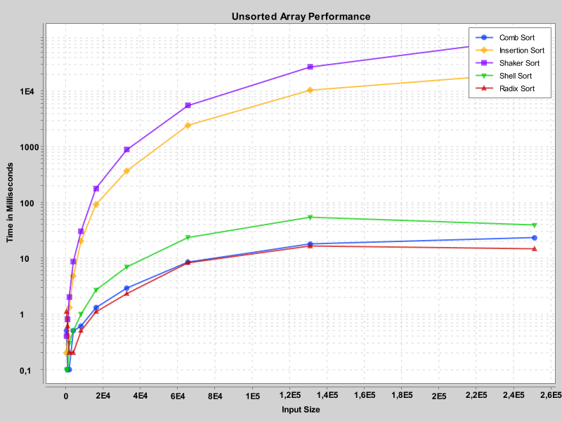

# Algorithms and Data Structures

Course projects from the Data Structures and Algorithms courses at Hacettepe University, written in Java and C++.

| Folder | Language | Topic |
|---|---|---|
| [`01-sorting-benchmark`](01-sorting-benchmark) | Java | Insertion, Shell, Shaker, Comb and Radix sort, timed on sorted, reverse-sorted and random inputs from a traffic flow dataset |
| [`02-route-planner-cpp`](02-route-planner-cpp) | C++ | Route exploration across Turkish provinces using hand-written stack and queue classes, with priority and weather-restricted provinces and backtracking |
| [`03-dp-and-greedy`](03-dp-and-greedy) | Java | One optimisation problem solved with dynamic programming and another with a greedy algorithm |
| [`04-genome-clustering`](04-genome-clustering) | Java | Genomes read from XML, grouped into linked clusters, with Dijkstra used to evaluate paths between them |
| [`05-campus-navigator`](05-campus-navigator) | Java | Fastest route planning on a campus map with Dijkstra and a priority queue, plus a project schedule planner that reads tasks from XML |

## Sorting benchmark plots



The sorting benchmark uses [XChart](https://knowm.org/open-source/xchart/) to draw its plots. Add `xchart-3.8.8.jar` to the classpath to run it.

## Running

Java projects:

```bash
javac *.java
java Main SafesDiscovered.dat ArtifactsFound.dat           # 03-dp-and-greedy
java Main AlienFlora.xml                                   # 04-genome-clustering
java Main projects.xml campus_navigator.dat                # 05-campus-navigator
```

C++ project (arguments: max distance, start city, distance file, priority file, restricted file):

```bash
g++ -o route_planner *.cpp
./route_planner 250 5 distance_data.csv priority_provinces.txt weather_restricted_provinces.txt
```
